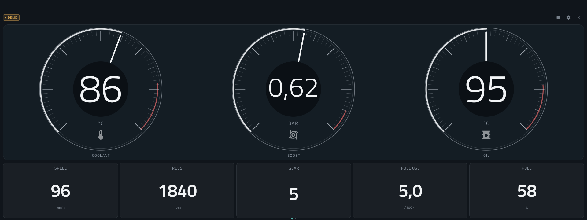
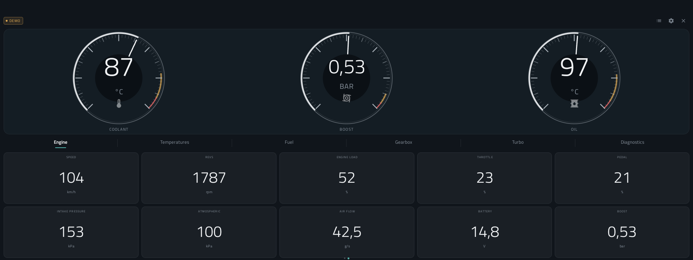
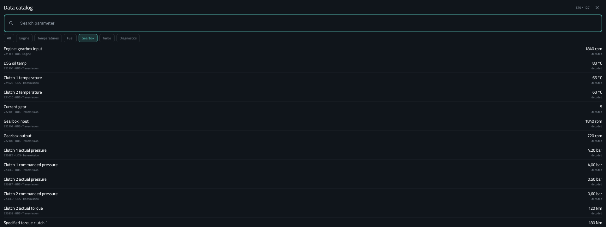
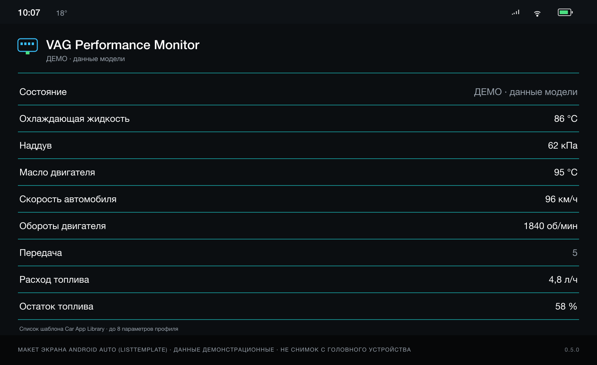
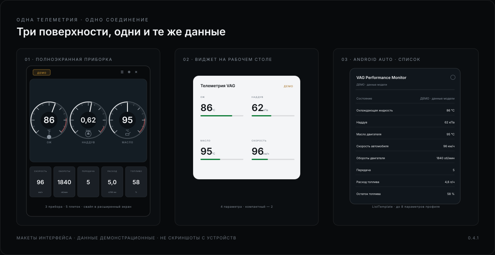

<p align="center">
  
</p>

<p align="center">
  <b>English</b> · <a href="README.ru.md">Русский</a>
</p>

<p align="center">
  <a href="https://github.com/nchalexz/AAPerformanceMonitor/releases"></a>
  <a href="LICENSE"></a>
  <a href="#install"></a>
  <a href="build.gradle.kts"></a>
  <a href="build.gradle.kts"></a>
  <a href="#security-and-privacy"></a>
</p>

<p align="center">
  <strong>Extended telemetry for Volkswagen, Audi, Škoda, Seat and Cupra through an ordinary ELM327.</strong><br>
  Dashboard, home-screen widget and car screen on one connection. No GMS, no account, no cloud.
</p>

<p align="center">
  <a href="#interface">Interface</a> ·
  <a href="#android-auto">Android Auto</a> ·
  <a href="#install">Install</a> ·
  <a href="#what-already-works">Features</a> ·
  <a href="#what-is-tested-what-is-not">Status</a> ·
  <a href="#build">Build</a> ·
  <a href="#architecture">Architecture</a> ·
  <a href="#documentation">Documentation</a>
</p>

> [!WARNING]
> **0.3.0 is a test build, not a verified release.**
> It runs on an Android 15 emulator against a software ELM327 stub, but it has **not been tested in a
> car**, on a real phone, on an Android Auto head unit or on live Bluetooth/USB adapters. No signal
> has been confirmed on a vehicle. See [What is tested](#what-is-tested-what-is-not).

> [!NOTE]
> **По-русски.** 0.3.0 — тестовая сборка для телеметрии VAG: 45 сигналов, приборка, виджет и
> отдельная AA-сборка. Проверено на эмуляторе Android 15 с программной заглушкой ELM327; на
> реальном автомобиле, телефоне и головном устройстве — нет. Сборки `standard` и `aa` используют
> один `applicationId`, поэтому ставьте только одну. Полный перевод и подробности —
> [README.ru.md](README.ru.md).

## What this is

AA Performance Monitor is a standalone Android app for continuous VAG telemetry. It grew out of the
[VAG Diag](https://github.com/gdm0991/vagdiag) diagnostics core, but solves a different problem:
not a one-off fault scan, but gauges that stay in view while you drive.

One telemetry service feeds the dashboard, the home-screen widget and the car screen. Those three
consumers share one ELM327 connection; the diagnostics screen still opens its own, so do not run a
block scan and telemetry at the same time.

The app has its own `applicationId`, name and icon, and installs next to VAG Diag. Google Mobile
Services are not required, there is no sign-up, and vehicle data never leaves the device.

Three principles shaped the app:

- **Honest data.** If a signal is unsupported, stale or not read yet, the UI shows “—” instead of
  zero.
- **One telemetry connection.** Dashboard, widget and car screen read one state stream and one
  adapter; diagnostics is a separate consumer.
- **Read-only UI.** The telemetry interface never writes to a control module. The inherited manual
  DTC clear is the only write path, and it requires an explicit tap.

## Interface

<p align="center">
  
  
  
</p>

<p align="center"><sub>Screenshots from the Android 15 emulator, running LIVE against a software ELM327 stub. They are not a car and not proof of compatibility.</sub></p>

| Part | What it does |
|---|---|
| **Driving** | Coolant, boost and oil temperature in three dials; speed, RPM, gear, fuel rate and fuel level in tiles. |
| **Performance** | Boost, calculated power and torque, RPM, load, fuel-rail pressure and temperatures. |
| **Data** | The full catalog with search, category filter, current value, PID/DID, ECU, protocol and verification status. |

The mode is switched in **Settings**: **Connect** for ELM327 or **Demo**. When a connection is
active, the dashboard header offers a quick return to demo; the gear icon opens vehicle and adapter
settings.

## Android Auto

<p align="center">
  
</p>

<p align="center"><sub>Render of the actual <code>ListTemplate</code>, not a head-unit screenshot. A real screenshot is not available: the emulator ships stub Android Auto, and neither DHU nor a head unit was tested.</sub></p>

Android Auto is a separate **`aa`** build, not a mode of the standard one. It replaces `standard`
(both share one `applicationId`) and adds a `CarAppService` from Car App Library 1.7.0.

- The screen is a template list: connection state plus up to eight parameters from the selected
  profile. Values update from the same `Telemetry` state.
- The stock host does not allow arbitrary Canvas content, so this is a list, not a copy of the
  dashboard. The full dashboard remains in the regular build.
- `HostValidator.ALLOW_ALL_HOSTS_VALIDATOR` is used for sideloading and AARE. Publishing on Google
  Play would require a host allowlist and category review.
- The build has not been tested on a head unit or in the Desktop Head Unit. If a host does not list
  the app, that is a host limitation, not a missing `CarAppService`.
- To test locally, install `*-AA.apk`, connect the phone to a DHU or head unit and open
  “AA Performance” from the host app list.

More: [docs/AA.md](docs/AA.md) and [docs/AARE_DASHGRID.md](docs/AARE_DASHGRID.md).

## One telemetry — three surfaces

<p align="center">
  
</p>

<p align="center"><sub>A diagram, not screenshots: the dashboard, widget and car screen read one state.</sub></p>

| Surface | What it shows | Connection |
|---|---|---|
| **Phone dashboard** | Full-screen gauges and tiles with demo/live switching. | Shared `Telemetry` state |
| **Home-screen widget** | Up to four parameters or a compact two-parameter layout. | Shared `Telemetry` state |
| **Android Auto / AARE** | A template list in the `aa` build; on AARE the full dashboard runs as a normal Activity. | Shared `Telemetry` state |

All three read one `StateFlow` from the process-wide `Telemetry` object, and the widget is refreshed by
`TelemetryService`. A second OBD session is not opened. The diagnostics screen is the exception: it
owns its own `Elm327`, so the two should not scan at the same time.

## What already works

**Telemetry**

- 45 signals: 41 standard OBD-II PIDs, 3 calculated values and 1 virtual signal.
- A subscription engine with dashboard priority, adaptive polling, exponential backoff and data-age
  tracking.
- Calculated torque, power and boost; they turn into “no data” when their inputs are missing or
  stale.
- One process-wide repository: dashboard, widget and car screen read the same `StateFlow`.
- Last-value cache, saved adapter and auto-connect on app start.

**Dashboard**

- Three screens: Driving, Performance and the Data catalog.
- Dark VAG cluster styling: thin scales, large values, muted labels and red warning zones.
- Unsupported or stale signals show “—” instead of zero.
- Demo data is always marked with a **DEMO** badge.

**Settings and profiles**

- Adapter choice: Wi-Fi, Bluetooth SPP or USB serial, with connect, demo and disconnect in one place.
- Auto-connect to the saved adapter at launch.
- Editable profiles: VAG MQB and a generic OBD-II profile, with a manual signal selection.
- A VIN field exists, but there is no automatic VIN lookup yet.

**Widget and Android Auto**

- “Telemetry AA” widget: up to four parameters or a compact two-parameter layout, per-instance
  configuration, light/dark theme and tap-to-open.
- `aa` build with Android Auto through Car App Library 1.7.0: connection state and up to eight
  profile parameters in a template list.
- The `standard` build has no car dependencies and does not declare `CarAppService`.
- A foreground service with a notification keeps the process alive and refreshes the widget while
  telemetry is needed.

**Diagnostics and AARE**

- ELM327 transports: Wi-Fi, Bluetooth SPP and USB serial (CH340, FTDI, CP210x, PL2303).
- The inherited VAG Diag screen: connect, scan modules, read and manually clear DTCs, OBD-II engine
  data, live data and a report.
- The full dashboard can run on AARE/DashGrid as a normal Android app. There is no host integration
  and no DashGrid AppWidgetHost support yet.

**Verification**

- 25 JVM tests: decoding, catalog integrity, payload parsing, polling schedule, backoff, staleness and
  demo-model consistency.
- Demo mode opens every screen without an adapter or a car.
- Dashboard, Data, settings and LIVE via the ELM327 stub were checked on an Android 15 emulator. The
  widget was placed on the launcher and its configurator saves parameters; live widget updates were
  not verified. A real phone and car were not tested.

## Install

The two builds share one `applicationId` and **replace each other** when installed. Pick one:

| Build | What is inside | Size |
|---|---|---|
| `standard` | Dashboard, widget, diagnostics; no Android Auto. | ≈18.9 MB |
| `aa` | The same plus Android Auto (Car App Library). | ≈20.2 MB |

Requirements: Android 7.0+ (API 24), an ELM327 over Wi-Fi, Bluetooth SPP or USB serial, and network,
Bluetooth, USB-host and notification permissions. Google Mobile Services are not required.

1. Download the APK you need from [Releases](https://github.com/nchalexz/AAPerformanceMonitor/releases).
2. Allow installs from unknown sources when Android asks, then open the file.
3. The app installs separately from VAG Diag.

Through `adb`:

```sh
# standard build
adb install -r AA-Performance-Monitor-0.3.0-standard.apk

# Android Auto build
adb install -r AA-Performance-Monitor-0.3.0-AA.apk
```

<details>
<summary>SHA-256 and signing certificate</summary>

```text
ac125e4117362547899e87795737269d5234234b6905b613bd214ba41d6a6b6c  AA-Performance-Monitor-0.3.0-standard.apk
237b2c68e44e0425d957259d13c64f3defb929f539d43d0abb4c070a16581f8a  AA-Performance-Monitor-0.3.0-AA.apk
certificate SHA-256: 36df845b5efe80088341e5ddaf9e69817194871c1318f2638661526c5baff917
```

The APKs are signed with the Android Debug key (`CN=Android Debug`). Check with
`apksigner verify --print-certs <file>.apk`.

</details>

> [!NOTE]
> These are debug builds. They work for manual testing, but switching to a release signature will
> require uninstalling the app first. The two builds cannot be installed at the same time.

## Quick start

### Demo on the phone

1. Open the app; the diagnostics screen appears.
2. Tap the gauges icon in the top bar.
3. Switch between Driving, Performance and Data: values change coherently with no adapter and no car.
4. Open the gear icon to choose a profile, signal set and adapter.
5. Add the “Telemetry AA” widget from the launcher and pick up to four parameters.

### With an ELM327

1. Connect the adapter over Wi-Fi, Bluetooth or USB.
2. Open **Vehicle and adapter**, choose the adapter type and address, then tap **Connect**. The
   diagnostics screen can also connect.
3. Return to the dashboard: the badge changes to **LIVE** and the header shows the channel and
   voltage.
4. Compare RPM, speed and coolant temperature with the car’s own cluster.

If a module does not support a signal, it stays “—”. That is expected behaviour, not a rendering
bug.

### Widget

1. Long-press an empty spot on the launcher and choose **Widgets**.
2. Find **AA Performance Monitor → Telemetry AA**.
3. Pick a title and up to four parameters, then save.

> [!CAUTION]
> Keep the dashboard on while driving, but do not configure it on the move. Searching, switching
> screens and reading DTCs belong to a parked car.

## What is tested, what is not

| Check | How | Result |
|---|---|---|
| `standard` debug build | `./gradlew :app:assembleStandardDebug` | **yes** |
| `aa` debug build | `./gradlew :app:assembleAaDebug` | **yes** |
| 25 JVM tests | `./gradlew :app:testStandardDebugUnitTest` | **yes** |
| Android 15 emulator: dashboard, Data, settings, LIVE via ELM327 stub | emulator | **yes** |
| Widget placed and configured | Android 15 emulator launcher | **yes** |
| Widget live value updates | live connection | **no** |
| Real phone | hardware | **no** |
| Android Auto head unit / DHU | Car App Library host | **no** |
| AARE / DashGrid | actual host and display | **no** |
| Real car | VAG MQB vehicle | **no** |
| Bluetooth and USB on live adapters | hardware | **no** |

Unit tests, emulator runs and renders are **not** compatibility proof. The catalog still has 44
signals marked “decoded” and one “described”; none is confirmed on a vehicle. The exact open points
are in [TEST_PLAN.md](TEST_PLAN.md) and [COMPATIBILITY.md](COMPATIBILITY.md).

## Build

Needs JDK 17+ and Android SDK with platform 36 and build-tools 36.0.0:

```sh
echo "sdk.dir=/path/to/android-sdk" > local.properties

# standard build
./gradlew :app:assembleStandardDebug

# Android Auto build
./gradlew :app:assembleAaDebug
```

Outputs:

```text
app/build/outputs/apk/standard/debug/app-standard-debug.apk
app/build/outputs/apk/aa/debug/app-aa-debug.apk
```

Tests:

```sh
./gradlew :app:testStandardDebugUnitTest
```

<details>
<summary>Release signing</summary>

Signing reads environment variables; no passwords are stored in the repository:

```sh
export VAGDIAG_KEYSTORE=/path/to/keystore.jks
export VAGDIAG_STOREPASS=...
export VAGDIAG_KEYALIAS=...
export VAGDIAG_KEYPASS=...
./gradlew :app:assembleStandardRelease :app:assembleAaRelease
```

Without `VAGDIAG_KEYSTORE`, the release APK is unsigned.

</details>

## Architecture

```text
CockpitActivity     AppWidget     CarAppService (aa)     SettingsActivity
        └──────────────┴───────────────┴──────────────────┘
                 Telemetry (singleton, StateFlow)
                              │
                       TelemetryEngine  ──►  SignalCatalog
                              │
                       SignalSource
                       ├── DemoSignalSource   — no car required
                       └── Elm327SignalSource — OBD-II mode 01
                              │
                           Elm327  ──►  Transport (Wi-Fi / Bluetooth / USB)
```

`Telemetry` is the only owner of the telemetry connection and engine. Every surface subscribes to its
state and never opens a second telemetry session. `TelemetryService` runs alongside it for the
foreground status, notification and widget refresh.

The VAG Diag screen keeps its own `Elm327` and is outside this tree. Commands are serialized inside
one adapter object, but the two connections can still compete for the bus.

The catalog knows nothing about the engine, the engine knows nothing about Android, and the UI knows
nothing about the transport. That is why decoding and polling can be tested with plain JVM tests.

More: [ARCHITECTURE.md](ARCHITECTURE.md).

## Signal catalog

| Group | Signals |
|---|---:|
| Engine | 22 |
| Temperatures | 4 |
| Fuel | 10 |
| Emissions | 4 |
| Electrical | 1 |
| Diagnostics | 3 |
| Transmission | 1 (virtual) |
| **Total** | **45** |

Extended VAG DIDs (DSG, Haldex, DPF, engine-side boost) are not in the catalog yet: they need
verified identifiers and formulas, not guesses. See [SIGNAL_CATALOG.md](SIGNAL_CATALOG.md).

## Limitations

- No hardware verification: no real phone, car, head unit or live Bluetooth/USB adapter.
- Android Auto is a template list only. Google Play publication needs a host allowlist and category
  review; sideloading and AARE use `ALLOW_ALL_HOSTS_VALIDATOR`.
- AARE/DashGrid: no dedicated integration, and DashGrid’s AppWidgetHost is not implemented on the
  host side.
- Profiles are manual; there is no VIN-based selection.
- No extended DIDs, trip recording, history, graphs or export.
- No dashboard editor.
- No KWP2000 or TP2.0; BLE adapters are not supported.
- No automatic reconnect after a drop; auto-connect works at app start only.
- The `standard` and `aa` builds share one `applicationId` and cannot be installed together.
- Diagnostics opens its own adapter connection; do not scan modules while telemetry is running.

The next versions and priorities are in [ROADMAP.md](ROADMAP.md) and [BACKLOG.md](BACKLOG.md).

## Security and privacy

The app is a monitor. The telemetry interface only reads. The diagnostics screen inherited from VAG
Diag includes manual DTC clearing — the only write operation; it runs on an explicit tap and never
automatically.

Network access is used only for the Wi-Fi adapter. Vehicle data is not sent to third-party services;
there are no analytics, trackers or crash reporters. The foreground service shows a persistent
notification and does not hide its work.

The `aa` build uses `HostValidator.ALLOW_ALL_HOSTS_VALIDATOR` for sideloading and AARE. A Google Play
release would need a host allowlist. More: [SECURITY.md](SECURITY.md).

## Documentation

| File | About |
|---|---|
| [README.ru.md](README.ru.md) | Full Russian translation of this file |
| [ARCHITECTURE.md](ARCHITECTURE.md) | Layers, engine, shared connection, widget and AA |
| [RESEARCH.md](RESEARCH.md) | Sources studied, commit SHAs, licences, decisions |
| [SIGNAL_CATALOG.md](SIGNAL_CATALOG.md) | Catalog counts and signal origins |
| [COMPATIBILITY.md](COMPATIBILITY.md) | Cars, adapters, protocols and surfaces |
| [SECURITY.md](SECURITY.md) | Write boundaries, permissions, dependencies |
| [TEST_PLAN.md](TEST_PLAN.md) | Automated tests and manual scenarios |
| [ROADMAP.md](ROADMAP.md) | Stages and their state |
| [BACKLOG.md](BACKLOG.md) | Prioritized work |
| [docs/WIDGET.md](docs/WIDGET.md) | Widget sizes, themes and refresh |
| [docs/AA.md](docs/AA.md) | Android Auto build, templates and testing |
| [docs/AARE_DASHGRID.md](docs/AARE_DASHGRID.md) | Full dashboard on AARE/DashGrid |
| [docs/SPEC.md](docs/SPEC.md) | Full technical specification |
| [CHANGELOG.md](CHANGELOG.md) | Change history |
| [docs/releases/0.3.0.md](docs/releases/0.3.0.md) | 0.3.0 release notes |
| [THIRD_PARTY_NOTICES.md](THIRD_PARTY_NOTICES.md) | Code and asset provenance |

## Contributing

The project is open to help, but data beats enthusiasm:

- **Test on a car.** The checklist is in [TEST_PLAN.md](TEST_PLAN.md). Record results in
  [COMPATIBILITY.md](COMPATIBILITY.md), not in a chat thread.
- **Add signals carefully.** A new signal needs a verified PID/DID, formula and source. Until it is
  read on a car, its status stays “described” or “decoded”.
- **Report bugs.** Include adapter model, Android version, screen, steps to reproduce and, if
  possible, `adb logcat`.
- **Translate.** The English README is the main one; [README.ru.md](README.ru.md) is maintained
  alongside it.

## License

MIT. The diagnostics core is based on [VAG Diag](https://github.com/gdm0991/vagdiag) (MIT, commit
`c2d565f`). The catalog, telemetry engine, dashboard, widget and car screen were written for this
project. Titillium Web is used under the SIL Open Font License; AndroidX, Compose and Car App Library
are Apache 2.0; `usb-serial-for-android` is MIT. Details are in
[THIRD_PARTY_NOTICES.md](THIRD_PARTY_NOTICES.md).

Android Auto is a Google trademark; this project is not affiliated with Google.

<p align="center"><sub>Built for VAG — and for everyone who finds a temperature needle insufficient.</sub></p>
