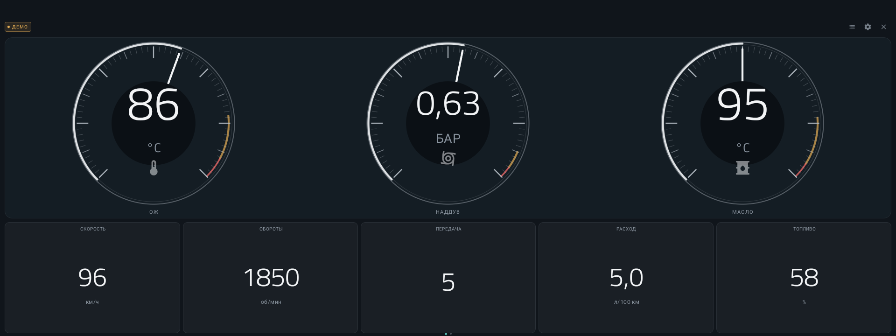
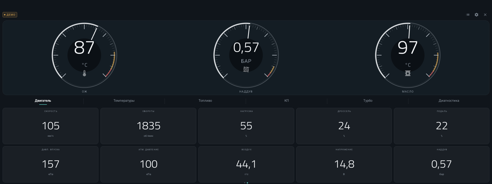
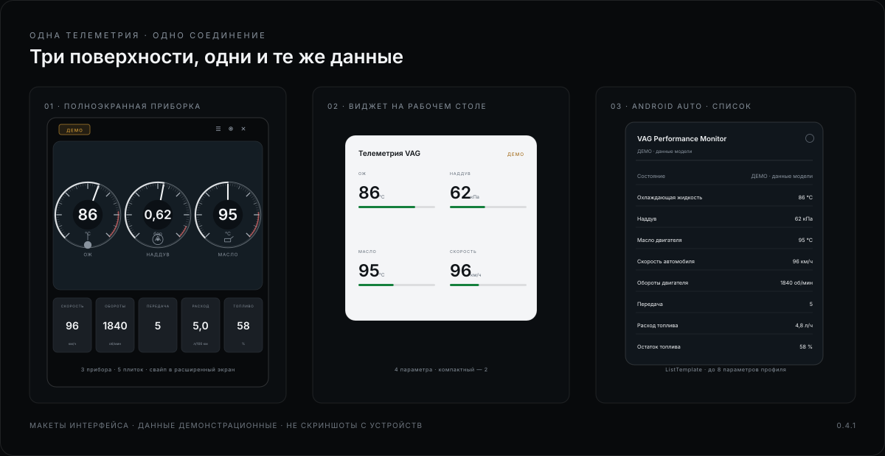

<p align="center">
  
</p>

<p align="center">
  <a href="README.md">English</a> · <b>Русский</b>
</p>

<p align="center"><sub>Полный русский перевод <a href="README.md">английского README</a>.</sub></p>

<p align="center">
  <a href="https://github.com/nchalexz/AAPerformanceMonitor/releases"></a>
  <a href="LICENSE"></a>
  <a href="COMPATIBILITY.md"></a>
  <a href="build.gradle.kts"></a>
  <a href="build.gradle.kts"></a>
  <a href="SECURITY.md"></a>
</p>

<p align="center">
  <strong>Расширенная телеметрия Volkswagen, Audi, Škoda, Seat и Cupra через обычный ELM327.</strong><br>
  Приборка, виджет и автомобильный экран на одном соединении. Без GMS, регистрации и облака.
</p>

<p align="center">
  <a href="#интерфейс">Интерфейс</a> ·
  <a href="#android-auto">Android Auto</a> ·
  <a href="#установка">Установка</a> ·
  <a href="#что-уже-работает">Возможности</a> ·
  <a href="#что-проверено-а-что-нет">Статус</a> ·
  <a href="#сборка">Сборка</a> ·
  <a href="#архитектура">Архитектура</a> ·
  <a href="#документация">Документация</a>
</p>

> [!WARNING]
> **0.4.0 — тестовая сборка, а не готовый продукт.**
> Она проверена на эмуляторе Android 15 с программной заглушкой ELM327, но
> ещё **не проверялась на автомобиле**, на реальном смартфоне, на головном
> устройстве Android Auto и на живых адаптерах Bluetooth или USB. Ни один
> сигнал не имеет статуса «подтверждён на автомобиле». Подробности —
> в разделе [«Что проверено, а что нет»](#что-проверено-а-что-нет).

> [!NOTE]
> 0.4.0 содержит новый интерфейс и VAG UDS-каталог, описанные ниже. Сборка
> по-прежнему не проверена на автомобиле, головном устройстве и живых адаптерах.

## Что это

AA Performance Monitor — самостоятельное Android-приложение для непрерывной
телеметрии автомобилей VAG. Оно выросло из диагностического ядра
[VAG Diag](https://github.com/gdm0991/vagdiag), но решает другую задачу:
не разовый поиск неисправностей, а приборы, которые постоянно находятся
перед глазами.

Одна служба телеметрии отдаёт данные приборной панели, виджету на рабочем
столе и автомобильному экрану. Эти три потребителя делят одно соединение
с ELM327. Диагностический экран по-прежнему открывает собственное —
не запускайте сканирование блоков одновременно с телеметрией.

Приложение ставится рядом с VAG Diag: у него свой `applicationId`, имя
и иконка. Google Mobile Services не нужны, регистрации нет, данные
автомобиля никуда не отправляются.

Три принципа, по которым принимались решения:

- **Честные данные.** Если сигнал не поддерживается, устарел или ещё не
  прочитан, показывается «—», а не ноль.
- **Одно соединение для телеметрии.** Приборка, виджет и автомобильный
  экран читают один поток состояния и один адаптер; диагностика — отдельный
  потребитель.
- **Только чтение.** Новый интерфейс телеметрии ничего не пишет в блоки.
  Унаследованное ручное стирание ошибок — единственное исключение, и оно
  выполняется только по нажатию пользователя.

## Интерфейс

<p align="center">
  
  
  
</p>

<p align="center"><sub>Снимки с эмулятора Android 15, 1920×720, режим ДЕМО. Это не автомобиль и не подтверждение совместимости.</sub></p>

| Часть | Что показывает |
|---|---|
| **Главный экран** | ОЖ, наддув и температура масла в трёх аналогово-цифровых приборах; скорость, обороты, передача, мгновенный расход и остаток топлива в пяти плитках. Открывается по умолчанию. |
| **Расширенный экран** | Те же три прибора меньше, панель категорий (двигатель, температуры, топливо, КП, турбо, диагностика) и адаптивная сетка: пять колонок на широком экране. Нажатие на прибор открывает его категорию. |
| **Каталог данных** | Все 129 сигналов: поиск, фильтр по категориям, значение, запрос (PID/DID), блок, протокол и статус проверки. |
| **Дневная тема** | Та же композиция на отдельных светлых токенах, а не инверсия картинки: [screen-day.png](docs/assets/screen-day.png). |

Экраны листаются горизонтальным свайпом. Тема и язык подписей выбираются
в **Настройках → Приборка**: авто / день / ночь и система / English / русский.
По умолчанию английский, на русской системе подписи переключаются сами.
Выбранная категория сохраняется между запусками, а главный экран всегда
открывается первым.

## Android Auto

<p align="center">
  
</p>

<p align="center"><sub>Макет по фактическому шаблону <code>ListTemplate</code>, а не снимок с головного устройства. Реального снимка пока нет: в эмуляторе стоит stub Android Auto, DHU и головное устройство не проверялись.</sub></p>

Android Auto — это отдельная сборка **`aa`**, а не режим обычной. Она
ставится вместо `standard` (у них один `applicationId`) и добавляет
`CarAppService` из Car App Library 1.7.0.

- Экран — шаблонный список: состояние подключения и до восьми параметров
  выбранного профиля. Значения обновляются из того же `Telemetry`.
- Штатный хост не разрешает произвольный Canvas, поэтому это список,
  а не копия приборки. Полноэкранная приборка остаётся в обычной сборке.
- `HostValidator.ALLOW_ALL_HOSTS_VALIDATOR` нужен для сайдлоада и AARE.
  Для публикации в Google Play потребуется белый список хостов и проверка
  категории.
- На головном устройстве и в Desktop Head Unit сборка пока не проверялась.
  Если хост не покажет приложение в своём списке, это ограничение хоста,
  а не отсутствие `CarAppService` в APK.

Проверить локально: установить `*-AA.apk`, подключить телефон к DHU или
головному устройству, открыть «AA Performance» в списке приложений.
Подробнее — [`docs/AA.md`](docs/AA.md) и
[`docs/AARE_DASHGRID.md`](docs/AARE_DASHGRID.md).

## Одна телеметрия — три поверхности

<p align="center">
  
</p>

<p align="center"><sub>Схема, а не скриншоты: приборка, виджет и шаблон автомобильного экрана читают одно состояние.</sub></p>

- **Приборка** — полный экран с тремя колодцами и плитками. Основной режим
  для телефона, планшета и AARE/DashGrid.
- **Виджет** — до четырёх параметров или компактный вариант на два.
  Настраивается отдельно для каждого экземпляра, поддерживает светлую
  и тёмную тему и обновляется из службы телеметрии.
- **Android Auto** — отдельная сборка `aa` с шаблонным списком: состояние
  и до восьми параметров выбранного профиля. Штатный хост не даёт
  произвольный Canvas, поэтому это список, а не копия приборки.

Подробнее: [`docs/WIDGET.md`](docs/WIDGET.md),
[`docs/AA.md`](docs/AA.md), [`docs/AARE_DASHGRID.md`](docs/AARE_DASHGRID.md).

## Что уже работает

**Телеметрия**

- Каталог из **129 сигналов**: 41 стандартный OBD-II PID, 4 вычисляемых,
  1 виртуальный и 83 VAG-специфичных сигнала UDS `22 <DID>` для MQB TDI.
- Движок с подписками, честным чередованием OBD и UDS, адаптивной частотой,
  экспоненциальным backoff и контролем возраста данных.
- Вычисляемые момент, мощность, наддув и мгновенный расход л/100 км.
  При устаревании зависимостей они становятся «нет данных»; на стоянке
  расход не определён, а не бесконечен.
- Единый процесс-репозиторий: приборка, виджет и автомобильный экран
  читают один `StateFlow`, второй сессии телеметрии нет.
- Кэш последних значений, сохранение адаптера и автоподключение при запуске.

**Приборная панель и интерфейс**

- Главный и расширенный экраны плюс каталог поверх приборки; свайп,
  переход с прибора в категорию и возврат назад.
- Три аналогово-цифровых прибора и пять плиток, затем адаптивная сетка
  на пять колонок — композиция из макетов.
- Дневная и ночная темы на отдельных токенах; «авто» следует системе,
  вручную можно выбрать день или ночь.
- Подписи на английском и русском. Английский по умолчанию, русский
  на русской системе, ручное переключение в настройках.
- Неподдерживаемый, устаревший или отсутствующий сигнал показывается как «—»
  с точкой статуса, а не нулём.
- ДЕМО стартует со значениями из макетов (86 °C, 0,62 бар, 95 °C, 96 км/ч,
  1840 об/мин, передача 5, 48 %, 21 %, 19 %, 162 кПа, 100 кПа, 42,5 г/с,
  14,6 В, 58 %) и всегда помечено **ДЕМО**.

**VAG-специфичные данные**

- Чтение UDS `22 <DID>` через ELM327: заголовок своего блока, 11-битный CAN,
  повтор при обрезанном многокадровом ответе и короткий кэш по DID.
  Следующий OBD-запрос возвращает заголовок `7DF`.
- 83 сигнала из открытого набора **OBDb/Audi-Q3** (CC BY-SA 4.0, коммит
  `b51e835`): фактический и заданный наддув, давление в рампе, коррекции
  форсунок, температура масла DSG и сцеплений, давления K1/K2, сажа DPF,
  температуры выхлопа, датчик АКБ и температура масла двигателя и щитка.
- Только чтение: отправляются `22` и `3E`. Сигналы, которым нужна расширенная
  сессия `10 03`, исключены; кодирования, адаптаций и тестов исполнительных
  механизмов нет.
- У каждого VAG-сигнала статус **«декодирован»**, а не «подтверждён на
  автомобиле». Пока это не доказано машиной.

**Настройки и профили**

- Выбор адаптера: Wi-Fi, Bluetooth SPP или USB-serial; подключение, ДЕМО
  и отключение из одного экрана.
- Автоподключение к сохранённому адаптеру при старте приложения.
- Ручные профили автомобиля: VAG MQB и универсальный OBD-II.
  Набор отображаемых параметров выбирается вручную.
- Тема приборки и язык подписей сохраняются между запусками.
- Поле VIN есть, но автоматического определения по VIN пока нет.

**Виджет и Android Auto**

- Виджет «Телеметрия AA»: до четырёх параметров или компактный на два,
  отдельная настройка каждого экземпляра, светлая и тёмная тема, переход
  в приборку по нажатию.
- Сборка `aa` с Android Auto через Car App Library 1.7.0: состояние
  подключения и до восьми параметров профиля в шаблонном списке.
- Обычная сборка `standard` не содержит автомобильных зависимостей
  и не объявляет `CarAppService`.
- Foreground-служба с уведомлением держит процесс и обновляет виджет, пока
  телеметрия нужна в фоне.

**Диагностика и AARE**

- Транспорты ELM327: Wi-Fi, Bluetooth SPP и USB-serial (CH340, FTDI,
  CP210x, PL2303).
- Унаследованный экран VAG Diag: подключение, поиск блоков, чтение и ручное
  стирание ошибок, OBD-II двигателя, live data и отчёт.
- Полноэкранную приборку можно запустить на AARE/DashGrid как обычное
  Android-приложение. Отдельной интеграции с хостом и поддержки AppWidgetHost
  в DashGrid пока нет.

**Проверяемость**

- 50 JVM-тестов: декодирование, битовые поля UDS, целостность каталога,
  разбор ответов, расписание опроса, backoff, устаревание, расход топлива
  и согласованность ДЕМО-модели.
- Тест на поддельном транспорте ELM327 проверяет переключение заголовков
  OBD → UDS и отрицательный ответ UDS.
- Демонстрационный режим открывает все экраны без адаптера и автомобиля.
- Главный, расширенный экран, каталог, настройки, темы и языки проверены
  на эмуляторе Android 15 при 1920×720. На реальном устройстве, головном
  устройстве и автомобиле — нет.

## Установка

Две сборки используют один `applicationId` и **заменяют друг друга** при
установке. Выберите один вариант:

| Сборка | Что внутри | Размер |
|---|---|---|
| `standard` | приборка, виджет, диагностика; без Android Auto | ≈18,8 МБ |
| `aa` | то же плюс Android Auto (Car App Library) | ≈20,1 МБ |

Требования: Android 7.0+ (API 24), ELM327 Wi-Fi / Bluetooth SPP /
USB-serial, разрешения на сеть, Bluetooth, USB-хост и уведомления.
Google Mobile Services не нужны.

1. Скачайте нужный APK со страницы
   [Releases](https://github.com/nchalexz/AAPerformanceMonitor/releases).
2. Разрешите установку из неизвестных источников и откройте файл.
3. Приложение установится отдельно от VAG Diag.

Через `adb`:

```sh
# обычная сборка
adb install -r AA-Performance-Monitor-0.4.0-standard.apk

# сборка с Android Auto
adb install -r AA-Performance-Monitor-0.4.0-AA.apk
```

<details>
<summary>Контрольные суммы SHA-256</summary>

```text
072e127c68b3c418e9cad40030d9f05d8fa6088661f1bf26f553033423ce8816  AA-Performance-Monitor-0.4.0-standard.apk
c383041c8e6fffe0d97efdb9aec38d429b73d503fc1ffd2e3e7c5c33162c484b  AA-Performance-Monitor-0.4.0-AA.apk
certificate SHA-256: 36df845b5efe80088341e5ddaf9e69817194871c1318f2638661526c5baff917
```

</details>

> [!NOTE]
> Это debug-сборки, подписанные ключом `CN=Android Debug`. Для обычного
> использования они подходят, но при переходе на release-подпись Android
> потребует удалить приложение перед установкой новой версии. Две сборки
> нельзя установить одновременно.

## Быстрый старт

### Демо

1. Запустите приложение — откроется диагностический экран.
2. Нажмите иконку приборов в верхней панели.
3. Листайте главный и расширенный экран, открывайте категории: бейдж **ДЕМО**
   показывает, что данные смоделированы; адаптер и автомобиль не нужны.
4. Откройте шестерёнку: там выбирается профиль автомобиля, набор параметров
   и адаптер.
5. Добавьте виджет «Телеметрия AA» на рабочий стол и выберите до четырёх
   параметров.

### С реальным адаптером

1. Подключите ELM327 по Wi-Fi, Bluetooth или USB.
2. Откройте **«Автомобиль и адаптер»** → выберите тип адаптера и адрес →
   **«Подключиться»**. Диагностический экран тоже умеет подключаться.
3. Вернитесь в приборку: бейдж сменится на **LIVE**, в шапке появится
   канал и напряжение.
4. Сверьте обороты, скорость и температуру ОЖ с приборкой автомобиля.

Если сигнал не поддерживается блоком, останется «—». Это ожидаемое
поведение, а не ошибка отображения.

> [!CAUTION]
> Приборку можно держать включённой в движении, но не настраивайте её на ходу.
> Поиск, смена экранов и чтение ошибок — только на стоящем автомобиле.

## Что проверено, а что нет

| Проверка | Как | Результат |
|---|---|---|
| Сборка `standard` debug | `./gradlew :app:assembleStandardDebug` | **да** |
| Сборка `aa` debug | `./gradlew :app:assembleAaDebug` | **да** |
| JVM-тесты | `./gradlew :app:testStandardDebugUnitTest`, 50 тестов | **да** |
| Эмулятор Android 15 (API 35) | главный, расширенный экран, каталог, настройки, темы и языки, LIVE через заглушку ELM327 | **да** |
| VAG UDS: разбор DID и переключение заголовков OBD/UDS | поддельный транспорт ELM327, JVM-тест | **да** |
| Виджет в меню виджетов | эмулятор Android 15 | **да** |
| Виджет на лаунчере | размещён и настроен; обновление значений при живом соединении | **частично** |
| Раскладка на реальном смартфоне | устройство без GMS | **нет** |
| Android Auto на головном устройстве / DHU | Car App Library, реальный хост | **нет** |
| AARE / DashGrid | конкретный хост и разрешение | **нет** |
| Реальный автомобиль | платформа VAG MQB | **нет** |
| Bluetooth и USB на живых адаптерах | проверка с адаптерами | **нет** |

Эмуляция и ДЕМО **не являются** подтверждением совместимости с автомобилем.
Это правило записано в ТЗ и соблюдается в документации: у 128 сигналов статус
«декодирован» и только у одного — «описан». Статус «подтверждён» пока не
получил ни один сигнал. 83 VAG DID ещё ни разу не отвечали на живом MQB TDI.

## Сборка

Нужны JDK 17+, Android SDK с platform 36 и build-tools 36.0.0.

```sh
echo "sdk.dir=/path/to/android-sdk" > local.properties

# обычная сборка
./gradlew :app:assembleStandardDebug

# сборка с Android Auto
./gradlew :app:assembleAaDebug
```

APK:

```text
app/build/outputs/apk/standard/debug/app-standard-debug.apk
app/build/outputs/apk/aa/debug/app-aa-debug.apk
```

Тесты:

```sh
./gradlew :app:testStandardDebugUnitTest
```

Для подписанного release-APK задайте переменные окружения — паролей в
репозитории нет:

```sh
export VAGDIAG_KEYSTORE=/path/to/keystore.jks
export VAGDIAG_STOREPASS=...
export VAGDIAG_KEYALIAS=...
export VAGDIAG_KEYPASS=...
./gradlew :app:assembleStandardRelease :app:assembleAaRelease
```

Если `VAGDIAG_KEYSTORE` не задан, release собирается неподписанным.

## Архитектура

```text
CockpitActivity     AppWidget     CarAppService (aa)     SettingsActivity
        └──────────────┴───────────────┴──────────────────┘
                 Telemetry (singleton, StateFlow)
                              │
                       TelemetryEngine  ──►  SignalCatalog
                              │
                       SignalSource
                       ├── DemoSignalSource   — модель, без автомобиля
                       └── Elm327SignalSource — OBD-II mode 01 и UDS 22 <DID>
                              │
                           Elm327  ──►  Transport (Wi-Fi / Bluetooth / USB)
```

`Telemetry` — единственный владелец соединения и движка телеметрии. Все
представления подписываются на его состояние и не создают вторую сессию.
Рядом живёт `TelemetryService`: foreground-статус, уведомление и обновление
виджетов.

Диагностический экран VAG Diag работает со своим `Elm327` и не входит
в это дерево. Команды синхронизированы внутри объекта, но два соединения
могут конкурировать за шину — не запускайте сканирование одновременно
с телеметрией.

Каталог не знает о движке, движок — об Android, интерфейс — о транспорте.
Поэтому декодирование и расписание опроса проверяются обычными JVM-тестами.

Подробнее: [`ARCHITECTURE.md`](ARCHITECTURE.md).

## Каталог сигналов

| Группа | Сигналов |
|---|---:|
| Двигатель | 34 |
| Температуры | 13 |
| Топливо | 20 |
| Экология | 4 |
| Электрика | 1 |
| Диагностика | 27 |
| Трансмиссия | 30 |
| **Всего** | **129** |

Из них 41 измеряемый OBD-II PID, 4 вычисляемых, 1 виртуальный и 83 VAG UDS.
VAG-набор собран из OBDb/Audi-Q3 (CC BY-SA 4.0); у всех статус «декодирован»,
ни один не подтверждён на автомобиле. Состав и происхождение —
[`SIGNAL_CATALOG.md`](SIGNAL_CATALOG.md) и [`tools/README.md`](tools/README.md).

## Ограничения

- Нет проверки на реальном устройстве, автомобиле, головном устройстве
  Android Auto и живых адаптерах Bluetooth/USB.
- Android Auto — только шаблонный список, без произвольного Canvas.
  Для публикации в Google Play нужен белый список хостов и проверка категории;
  в сборке для сайдлоада и AARE стоит `ALLOW_ALL_HOSTS_VALIDATOR`.
- AARE/DashGrid: отдельной интеграции нет; AppWidgetHost в DashGrid
  не реализован на стороне хоста.
- Профили выбираются вручную; определения по VIN нет.
- VAG DID взяты из одного открытого набора Audi-Q3. Они декодированы, но не
  подтверждены на MQB TDI: часть блоков откажет в DID или ответит только
  после `10 03`, а эту сессию приложение не открывает.
- Отправляются только чтение `22` и keep-alive `3E`. Нет импорта ODX/VCDS,
  смены сессии, кодирования, адаптаций и регенерации DPF.
- Нет записи поездок, истории, графиков и экспорта.
- Нет конструктора дашбордов; три прибора и пять плиток пока фиксированы.
- Нет KWP2000 и TP2.0; BLE-адаптеры не поддерживаются.
- Автоматического переподключения после обрыва нет: автоподключение работает
  только при запуске.
- Сборки `standard` и `aa` используют один `applicationId` и не могут стоять
  одновременно.
- Диагностический экран открывает собственное соединение с адаптером.
  Не запускайте сканирование блоков и телеметрию одновременно.

Ближайшие версии и приоритеты — в [`ROADMAP.md`](ROADMAP.md) и
[`BACKLOG.md`](BACKLOG.md).

## Безопасность

Приложение задумано как монитор. Новый интерфейс телеметрии выполняет только
чтение. Диагностический экран унаследован от VAG Diag вместе с ручным
стиранием ошибок — это единственная операция записи; она выполняется по
нажатию и никогда автоматически.

Сеть используется только для связи с Wi-Fi-адаптером. Данные автомобиля не
отправляются сторонним сервисам, аналитики и трекеров нет. Foreground-служба
показывает постоянное уведомление и не скрывает свою работу.

Для сборки `aa` используется `HostValidator.ALLOW_ALL_HOSTS_VALIDATOR`:
это нужно для сайдлоада и AARE, но для публикации в Google Play потребуется
белый список хостов. Подробнее: [`SECURITY.md`](SECURITY.md).

## Документация

| Файл | О чём |
|---|---|
| [`README.md`](README.md) | английский оригинал |
| [`ARCHITECTURE.md`](ARCHITECTURE.md) | слои, движок, общее соединение, ограничения |
| [`RESEARCH.md`](RESEARCH.md) | что изучено, commit SHA, лицензии, решения |
| [`SIGNAL_CATALOG.md`](SIGNAL_CATALOG.md) | счётчики и состав каталога |
| [`COMPATIBILITY.md`](COMPATIBILITY.md) | автомобили, адаптеры, протоколы, поверхности |
| [`SECURITY.md`](SECURITY.md) | границы записи, разрешения, зависимости |
| [`TEST_PLAN.md`](TEST_PLAN.md) | автотесты и ручные сценарии |
| [`ROADMAP.md`](ROADMAP.md) | этапы и их состояние |
| [`BACKLOG.md`](BACKLOG.md) | приоритетный список работ |
| [`docs/WIDGET.md`](docs/WIDGET.md) | виджет: размеры, темы, обновление |
| [`docs/AA.md`](docs/AA.md) | Android Auto: сборка, шаблоны, проверка |
| [`docs/AARE_DASHGRID.md`](docs/AARE_DASHGRID.md) | полноэкранная приборка на AARE |
| [`docs/SPEC.md`](docs/SPEC.md) | полное техническое задание |
| [`CHANGELOG.md`](CHANGELOG.md) | история изменений |
| [`docs/releases/0.4.0.md`](docs/releases/0.4.0.md) | релизные заметки 0.4.0 |
| [`docs/releases/0.3.0.md`](docs/releases/0.3.0.md) | релизные заметки 0.3.0 |
| [`docs/releases/0.2.0.md`](docs/releases/0.2.0.md) | релизные заметки 0.2.0 |
| [`THIRD_PARTY_NOTICES.md`](THIRD_PARTY_NOTICES.md) | происхождение кода и лицензии |

## Участие

Проект открыт для помощи, но данные важнее энтузиазма:

- **Проверка на автомобиле.** Методика — в [`TEST_PLAN.md`](TEST_PLAN.md).
  Результаты записывайте в [`COMPATIBILITY.md`](COMPATIBILITY.md), а не
  в переписку.
- **Новые сигналы.** Принимаются только с подтверждённым PID/DID, формулой
  и источником. До чтения на автомобиле статус остаётся «описан» или
  «декодирован».
- **Ошибки.** Приложите модель адаптера, версию Android, экран и шаги
  воспроизведения. Если возможно — лог `adb logcat`.

## Лицензия

MIT. Основа — Android-приложение [VAG Diag](https://github.com/gdm0991/vagdiag)
(MIT, commit `c2d565f`). Диагностическое ядро сохранено; каталог, движок
телеметрии, приборная панель, виджет и автомобильный экран написаны для
этого проекта. Titillium Web используется по SIL OFL; AndroidX, Compose и
Car App Library — Apache 2.0; `usb-serial-for-android` — MIT. Подробности — в
[`THIRD_PARTY_NOTICES.md`](THIRD_PARTY_NOTICES.md).

Android Auto — торговая марка Google; проект не связан с Google.

<p align="center"><sub>Сделано для VAG — и для всех, кому мало стрелки температуры.</sub></p>
