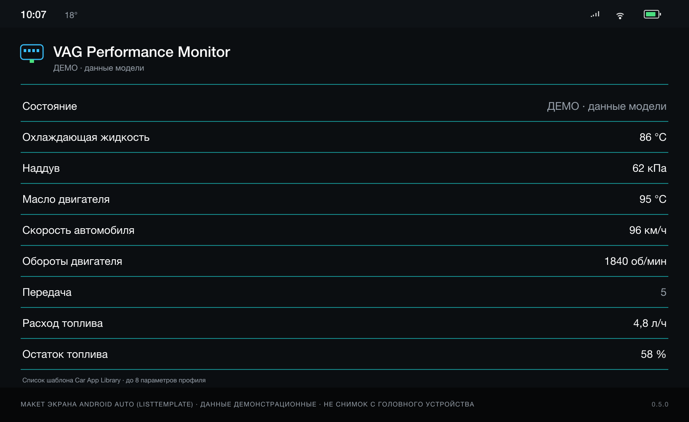

# Android Auto и AARE

  

Макет по фактическому шаблону ListTemplate, не снимок с головного устройства.

## Две сборки

| Флевор | Что внутри | Для чего |
|---|---|---|
| `standard` | Приборка, виджет, профили, ELM327 | Обычный телефон, AARE/DashGrid |
| `aa` | То же + `CarAppService` (`androidx.car.app`) | Проекция на Android Auto |

Обе сборки имеют один `applicationId`; устанавливается одна из двух.

## Что реально умеет штатный Android Auto

Штатный Android Auto не разрешает приложению рисовать произвольный
интерфейс. Для не-навигационных категорий доступны только шаблоны
Car App Library: списки, панели, сетки. Поэтому AA-сборка показывает
`ListTemplate` с реальными показателями и статусом подключения, а не
копию Canvas-приборки. Это ограничение платформы, а не недоделка.

- Категория: `androidx.car.app.category.IOT`.
- `HostValidator.ALLOW_ALL_HOSTS_VALIDATOR` — для сайдлоада и AARE.
  Для Google Play нужен белый список хостов и проверка категории.
- Приложение не публикуется в Play; установка APK вручную.
- Шаблонный экран обновляется при изменении состояния телеметрии.

## Как проверить

1. Установить `*-AA.apk`.
2. Подключить телефон к головному устройству с Android Auto
   (или использовать Desktop Head Unit, если он доступен).
3. Разрешить уведомления и Bluetooth.
4. В настройках приложения подключить ELM327 или оставить ДЕМО.
5. На головном устройстве открыть VAG Performance Monitor.

Без головного устройства/AA-эмулятора это **не проверено**. Сборка
компилируется, сервис и metadata присутствуют в manifest; фактическое
появление в лончере AA зависит от категории и политики хоста.

## AARE / DashGrid

AARE запускает обычные Android-приложения на головном устройстве.
`CockpitActivity` — обычная Activity, но она объявлена `exported="false"`
и в 0.4.1, и в 0.5.0. AARE или DashGrid покажут её только там, где хост
умеет запускать неэкспортированные Activity; отдельного экспортированного
входа в приборку нет. Ограничения — разрешение, плотность, касания и
поведение виртуального дисплея — проверяются на конкретном AARE/DashGrid.

VPM при этом остаётся **самостоятельным** приложением: приборка, виджет,
диагностика и AA-список работают на телефоне без DashGrid. Упоминание
AARE/DashGrid относится только к показу приборки на автомобильном экране,
где штатный Android Auto не рисует произвольный Canvas. Для DashGrid 1.3.0
предпочтительный путь — не запуск чужой Activity, а read-only мост:
DashGrid рисует свой кокпит по снимку VPM (см. [AARE_DASHGRID.md](AARE_DASHGRID.md)).

## Что не заявляется

- Произвольный Canvas-дашборд в штатном Android Auto.
- Публикация в Google Play без проверки.
- Проверенная работа на конкретном головном устройстве.
