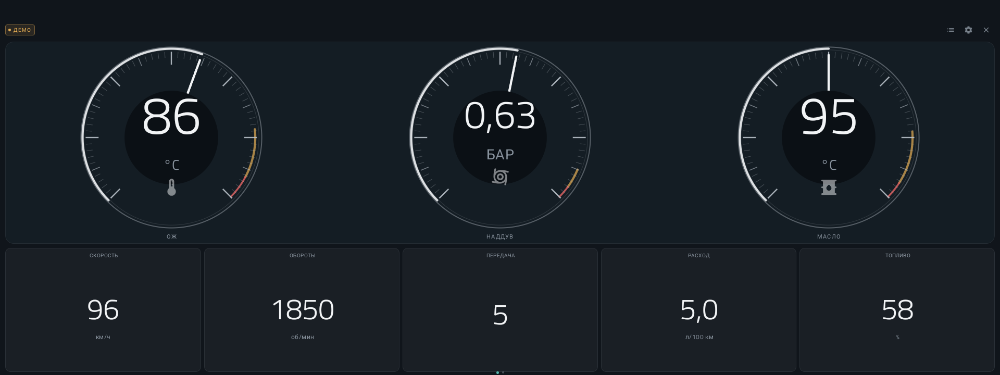
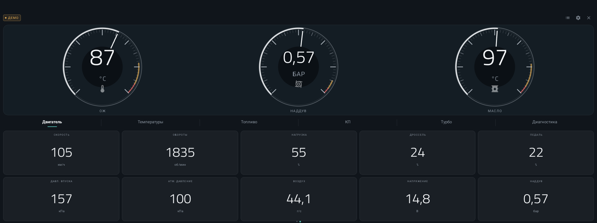
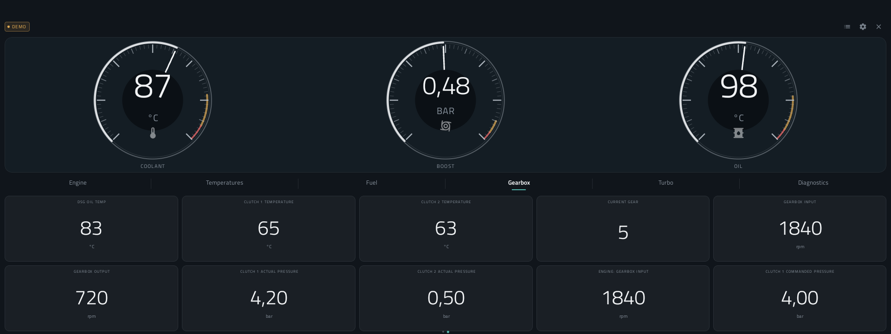
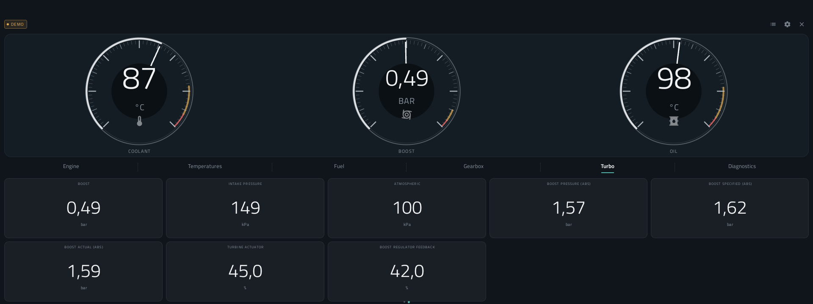

# Приборка: дизайн-система и компоненты

Документ описывает то, что реализовано в
[`cockpit/ui/`](../app/src/main/java/io/github/nchalexz/aaperfmon/cockpit/ui).
Макеты — визуальный референс; расхождения перечислены в конце и сделаны
осознанно.

  
  

1920×720, Android 15, ДЕМО. Не автомобиль и не подтверждение совместимости.

## Токены

| Токен | Ночь | День | Назначение |
|---|---|---|---|
| `background` | `#10151B` | `#E8ECEF` | фон экрана |
| `panel` | `#141D24` | `#F6F8FA` | панель приборов |
| `card` | `#1A1F25` | `#FFFFFF` | плитка |
| `border` | `#2A3037` | `#C3CBD3` | рамка |
| `text` | `#F2F4F6` | `#14191E` | значения |
| `dim` | `#89939E` | `#55606B` | подписи, единицы |
| `tick` | `#59636D` | `#8A949E` | мелкие деления |
| `ring` | `#B8C0C8` | `#4E5964` | кольцо и крупные деления |
| `accent` | `#54B6AD` | `#0F766E` | активная вкладка |
| `warning` | `#E5AE54` | `#9A5B00` | предупреждение |
| `critical` | `#D96060` | `#B3261E` | красная зона |
| `dialFace` | `#0B1015` | `#E1E7EC` | диск под значением |
| `needle` | `#F2F4F6` | `#1A2027` | стрелка |

Дневная тема — не инверсия готового изображения: у неё свои токены фона,
текста, стрелки, делений и границ. Контраст текста к фону не ниже 7:1,
плитки не чисто белые, чтобы не слепить на солнце.

Шрифт — Titillium Web из ресурсов. В нём нет кириллицы, поэтому русские
подписи Android подставляет системным шрифтом, а цифры остаются макетными.

## Компоненты

| Компонент | Файл | Что делает |
|---|---|---|
| `CircularGauge` | `Gauge.kt` | Двойное кольцо, 60 делений, дуга заполнения между кольцами, стрелка, красная/жёлтая зона, диск со значением, единицей и пиктограммой. |
| `MetricTile` | `Gauge.kt` | Подпись сверху, крупное значение в центре, единица сразу под ним; точка статуса для «—». |
| `MetricGrid` | `DashboardScreens.kt` | Адаптивная сетка: 2–5 колонок по ширине, две полные строки в видимой области, дальше скролл. |
| `CategoryTabBar` | `Chrome.kt` | Категории с подчёркиванием активной и тонкими разделителями. |
| `SourcePill` | `Chrome.kt` | Компактная плашка ДЕМО / LIVE / ошибка. |
| `CatalogOverlay` | `CatalogOverlay.kt` | Каталог всех сигналов поверх приборки, поиск и фильтр. |
| `DashboardScreen` | `DashboardScreens.kt` | Главный экран: три прибора и пять плиток. |
| `ExtendedDashboardScreen` | `DashboardScreens.kt` | Приборы меньше, панель категорий, сетка. |
| `MetricRegistry` | `MetricRegistry.kt` | Что и как показывать: подписи, единицы, множители, пороги, запасные источники. |

`DashboardTheme` держит токены и шрифт; `readMetric` — единая точка, где
сигнал превращается в число, «—» или причину отсутствия.

## Навигация

- Главный экран открывается по умолчанию.
- Горизонтальный свайп листает главный и расширенный экраны.
- Нажатие на прибор открывает его категорию на расширенном экране.
- Нажатие на категорию меняет сетку; выбранная категория сохраняется.
- Системная кнопка «назад» возвращает с расширенного экрана на главный.
- Настройки и выход — две иконки в правом верхнем углу; каталог — третья.
  Постоянных элементов управления больше нет.

## Состояния данных

У значения ровно одно из состояний: `OK`, `WAITING`, `STALE`,
`UNSUPPORTED`, `ERROR`, `OFFLINE`. Любое состояние кроме `OK` рисует «—»
и точку:

| Состояние | Точка | Причина |
|---|---|---|
| `WAITING` | серая | сигнал ещё не опрашивался |
| `STALE` | жёлтая | значение старше `max(3 с, 4 × интервал)` |
| `UNSUPPORTED` | тёмная | блок не поддерживает PID/DID |
| `ERROR` | красная | ответ не разобран |
| `OFFLINE` | красная | нет связи с адаптером |

Стрелка прибора при не-`OK` гаснет: замороженная стрелка выглядела бы как
свежее показание. Последнее известное число не подставляется.

## Источники и запасные варианты

`MetricSpec` может иметь несколько источников. Температура масла на MQB TDI
часто недоступна по PID `0x5C`, поэтому порядок такой:

1. `engine.oil_c` — стандартный OBD-II;
2. `vag.7e0.11be.oil_temp` — UDS из блока двигателя;
3. `vag.714.202f.oil_temp` — температура масла из щитка.

Показывается первый ответивший источник. Передача на главном экране так же
берётся из OBD-заглушки или из VAG `22 210F`. Это не подмена данных: в
каталоге видно, какой именно сигнал прочитан.

## Анимация и производительность

- Дуга заполнения рисуется между двумя кольцами от начала шкалы до текущего
  значения, под стрелкой и делениями.
- Стрелка интерполируется `tween(150 ms, LinearEasing)`: это сглаживание
  между кадрами телеметрии, а не задержка значения.
- Значение на плитке и в приборе обновляется сразу при изменении состояния.
- Перерисовывается только Canvas прибора и текст значения; список сигналов
  не пересобирается.
- Частота опроса задаётся источником; UDS-сигналы медленнее OBD.
- При открытом каталоге движок опрашивает каталог по одному сигналу, не
  отбирая шину у приборки.

## Адаптивность

- Размер прибора — `min(ширина ячейки, высота ряда)`, а не фиксированный dp.
- Главный экран: пять плиток в ряд от 700 dp; 3 + 2 на 500–700 dp; 2 + 2 + 1
  уже. На портретном экране приборы занимают половину высоты.
- Расширенный экран: 5 колонок на широком экране, 4/3/2 — на узком.
- Высота плитки в сетке считается из доступной высоты, чтобы две строки
  помещались без обрезания; остальное — вертикальный скролл.
- Полноэкранный режим: скрыты строка состояния и панель навигации.

## Осознанные расхождения с макетами

| Макет | Реализация | Почему |
|---|---|---|
| `FUEL USE 20,0 km/L` | `FUEL USE 5,0 l/100 km` | ТЗ требует л/100 км по умолчанию, единицы выбираются. 20 км/л = 5,0 л/100 км. |
| Четыре категории | Шесть: добавлены Turbo и Diagnostics | В ТЗ перечислены все шесть; в макете показаны только четыре. |
| `REVS` / `FUEL USE` | То же; язык переключается на русский | Английский по умолчанию, русский на русской системе. |
| Стрелка наддува `0,62` | Диапазон −1…2 бар | На макете шкала не подписана; диапазон выбран по смыслу и не выдаётся за критические пороги. |
| Красная зона на всех приборах | Жёлтая + красная по порогам | Пороги — значения отображения по умолчанию; профиль автомобиля сможет их переопределить. |
| `BOOST` 1,63 бар | Подписано `BOOST PRESSURE (ABS)` | VAG DID отдаёт абсолютное давление, а не разницу с атмосферным; смешивать их нельзя. |

## VAG-категории

  
  

Снимки 1920×720, ДЕМО. VAG-сигналы декодированы, но не подтверждены на автомобиле.

## Телефон

Портретная раскладка: панель приборов фиксируется по высоте от ширины
экрана, плитки идут по две в ряд и больше не растягиваются на всю высоту.
Снимки: [главный телефонный экран](assets/phone-main.png),
[настройки](assets/phone-settings.png), [приборка](assets/phone-cockpit.png).

## Проверка

- 50 JVM-тестов, включая битовые поля UDS, запасной источник масла и расход.
- Снимки 1920×720 на эмуляторе Android 15, ночь и день; портретные снимки
  телефона 1080×2400.
- На реальном MQB TDI интерфейс не проверялся; VAG DID не подтверждены.
