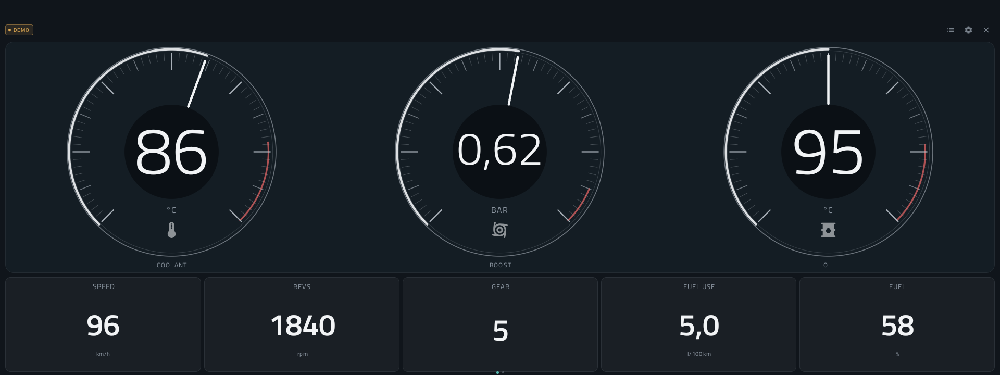
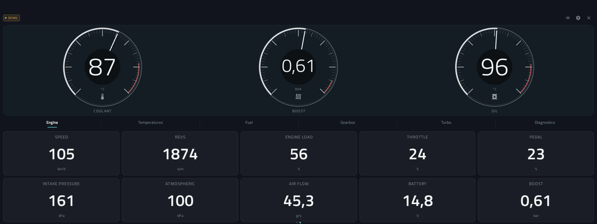

# DashGrid: эталоны экранов VAG Performance Monitor

Два экрана, которые DashGrid должен показывать в предустановленной панели.
Композиция, геометрия, токены и типографика — те же, что в VAG Performance Monitor (VPM) 0.4.1; это не
новый дизайн и не «похожий» виджет.

| Экран | Файл | Что показывает |
|---|---|---|
| Главный | [`01-main.png`](01-main.png) | Три аналогово-цифровых прибора; пять плиток: скорость, обороты, передача, расход, топливо |
| Категории | [`02-categories.png`](02-categories.png) | Те же приборы меньше; категории Engine / Temperatures / Fuel / Gearbox / Turbo / Diagnostics; адаптивная сетка |

  
  

1920×720, Android 15, ДЕМО. Это не автомобиль и не подтверждение совместимости.

## Как вписывать в DashGrid

- Панель занимает **100 % рабочего стола**; левый рейл и нижний док DashGrid
  остаются хостом и в макет не входят.
- Контент масштабируется целиком, а не отдельными элементами. Размер прибора
  — `min(ширина ячейки, высота ряда)`; прибор всегда круглый.
- Служебная строка VPM (каталог, настройки, закрыть) в панели **не
  дублируется**: навигацию даёт DashGrid. Индикатор **ДЕМО** остаётся, чтобы
  данные не были приняты за автомобиль.
- Свайп между главным и расширенным экраном и нажатие на прибор для перехода
  в категорию сохраняются, если DashGrid не забирает этот жест себе.
- Никаких дополнительных карточек, рамок, заголовков и фоновых панелей поверх
  макета не добавлять.

## Геометрия прибора

| Элемент | Позиция / размер |
|---|---|
| Центр прибора и значения | X=0, Y=0 |
| Внешний радиус | R |
| Радиус тёмного диска | 0.44R |
| Максимальная ширина значения | 0.78R |
| Центр единицы измерения | X=0, Y=0.54R |
| Центр пиктограммы | X=0, Y=0.73R |
| Размер пиктограммы | 0.18R |
| Название прибора | X=0, Y=1.15R |

Значение центрируется по реальным границам глифов, а не по baseline; размер
шрифта уменьшается, пока весь текст, включая запятую и минус, не впишется
в диск. Единица и пиктограмма лежат **вне** диска. Яркая дуга заполнения
между кольцами сохранена по требованию заказчика; красная зона — по эталону.

## Плитки

- Высота не растягивается на всю свободную высоту: на широком экране —
  0.48 ширины плитки, на узком (до 900 dp) — 0.72.
- Подпись сверху, значение по центру, единица сразу под значением.
- Подписи и единицы крупнее прежних; цифры SemiBold.
- Передача без единицы не смещает значение.
- «—» при отсутствии данных, а не ноль.

## Токены

| Токен | Ночь | День |
|---|---|---|
| Фон | `#10151B` | `#E8ECEF` |
| Панель | `#141D24` | `#F6F8FA` |
| Карточка | `#1A1F25` | `#FFFFFF` |
| Граница | `#2A3037` | `#C3CBD3` |
| Текст | `#F2F4F6` | `#14191E` |
| Вторичный | `#89939E` | `#55606B` |
| Акцент | `#54B6AD` | `#0F766E` |
| Предупреждение | `#E5AE54` | `#9A5B00` |
| Критическое | `#D96060` | `#B3261E` |

## Проверка

- 1920×720 — эталонные снимки;
- 1280×720, 800×480 и все раскладки DashGrid;
- день/ночь, RU/EN, значения `5`, `86`, `95`, `105`, `120`, `0,62`, `1,85`,
  `2,10`, `−0,35`, «—»;
- при одинаковых данных и размерах приборы VPM и DashGrid визуально
  идентичны.

Исходная реализация VPM: [`cockpit/ui/Gauge.kt`](../../app/src/main/java/io/github/nchalexz/aaperfmon/cockpit/ui/Gauge.kt)
и [`DashboardScreens.kt`](../../app/src/main/java/io/github/nchalexz/aaperfmon/cockpit/ui/DashboardScreens.kt).
