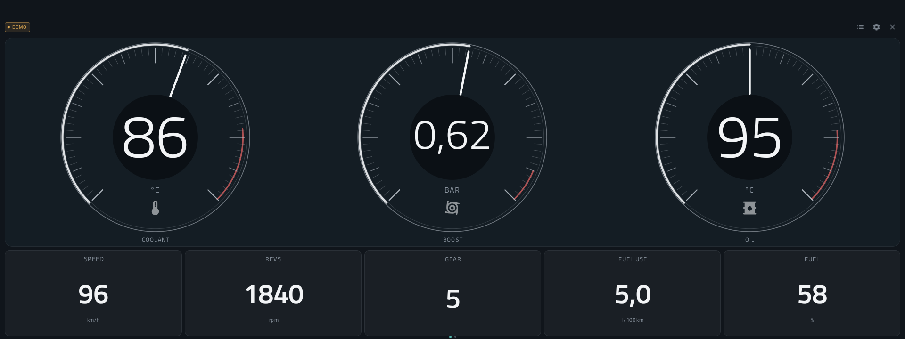
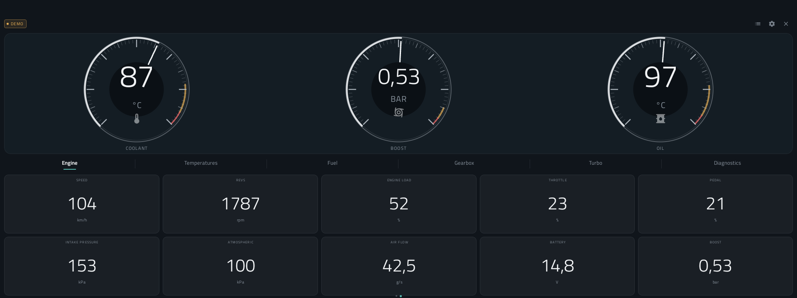

# VAG Performance Monitor 0.4.1

<p align="center">
  
</p>

**Дата:** 27 ноября 2026
**Версия:** 0.4.1, `versionCode` 5
**Статус:** тестовая сборка. Не проверена на автомобиле, головном устройстве
Android Auto и живых адаптерах Bluetooth/USB.

0.4.1 исправляет геометрию приборов и плиток по эталонным макетам и
переименовывает приложение в **VAG Performance Monitor**. Телеметрия,
VAG UDS и источники данных не менялись.

## Что исправлено

- Тёмный диск прибора уменьшен до 0.44R, значение центрируется по реальным
  границам глифов и целиком вписывается в диск, включая запятую и минус.
- Единица измерения вынесена под диск (0.54R), пиктограмма — под единицу
  (0.73R, размер 0.18R). Название прибора — под внешним кольцом (1.15R).
- Пиктограммы больше не пересекают границу диска; значение не задевает
  единицу.
- Плитки стали компактнее: высота зависит от ширины, подписи и единицы
  крупнее, цифры — SemiBold. На 800×480 работает компактная раскладка.
- Убрана янтарная заливка шкалы: осталась красная зона из эталона.
- Дуга заполнения между кольцами сохранена по требованию заказчика.
- Приложение и репозиторий переименованы; `applicationId` не менялся.

<p align="center">
  
  
</p>
<p align="center"><sub>Снимки 1920×720, Android 15, ДЕМО. Не автомобиль и не подтверждение совместимости.</sub></p>

## Установка

| Сборка | Что внутри | Размер |
|---|---|---|
| `standard` | приборка, виджет, диагностика; без Android Auto | ≈18,8 МБ |
| `aa` | то же плюс Android Auto (Car App Library) | ≈20,1 МБ |

```sh
adb install -r VAG-Performance-Monitor-0.4.1-standard.apk
adb install -r VAG-Performance-Monitor-0.4.1-AA.apk
```

<details>
<summary>SHA-256 и сертификат</summary>

```text
73bab2e5b910ab4f59ef24592845ae8be9031a8e722ef7f65bcc94e906128d15  VAG-Performance-Monitor-0.4.1-standard.apk
9b25899401b1957cf956be98fe9b0103f4ae2d2144cf7798ba3b6c0e13702d06  VAG-Performance-Monitor-0.4.1-AA.apk
certificate SHA-256: 8c5ded478ffa3ba33ae0f82e72ef7b1a1cd8ef2f522c84c803d7a22f24b31646
```

</details>

> [!NOTE]
> Это debug-сборки, подписанные ключом `CN=Android Debug`. CI-сборка
> подписывается своим debug-ключом; контрольные суммы опубликованного
> релиза указаны в описании GitHub Release.

## Что проверено

| Проверка | Как | Результат |
|---|---|---|
| Сборка `standard` и `aa` | `./gradlew assembleStandardDebug assembleAaDebug` | да |
| 50 JVM-тестов | `./gradlew testStandardDebugUnitTest testAaDebugUnitTest` | да, 0 падений |
| Главный и расширенный экран | эмулятор Android 15, 1920×720 и 1280×720 | да |
| Компактная раскладка | эмулятор, 800×480 | да |
| День и ночь, RU/EN | эмулятор | да |
| Реальный автомобиль | MQB TDI | нет |
| Головное устройство / DHU | реальный хост | нет |
| Живые Bluetooth/USB-адаптеры | железо | нет |

## Ограничения

- 83 VAG DID декодированы, но не подтверждены на MQB TDI.
- Android Auto — только шаблонный список; полные экраны — AARE/DashGrid.
- DashGrid-виджет синхронизируется отдельно; в AAPM общего UI-модуля пока нет.
- Нет записи поездок, истории, графиков и конструктора дашбордов.

## Документация

- [README.md](https://github.com/nchalexz/VAG-PerformanceMonitor/blob/main/README.md)
- [docs/UI.md](https://github.com/nchalexz/VAG-PerformanceMonitor/blob/main/docs/UI.md)
- [SIGNAL_CATALOG.md](https://github.com/nchalexz/VAG-PerformanceMonitor/blob/main/SIGNAL_CATALOG.md)
- [COMPATIBILITY.md](https://github.com/nchalexz/VAG-PerformanceMonitor/blob/main/COMPATIBILITY.md)
