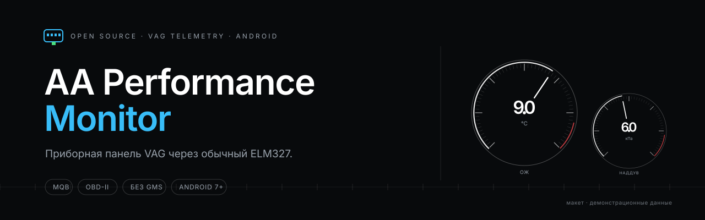

# VAG Performance Monitor 0.6.2

<p align="center">
  
</p>

**Дата:** 27 ноября 2026
**Версия:** 0.6.2, `versionCode` 11
**Статус:** тестовая сборка. Проверена на стоящей машине через
Bluetooth-адаптер **OBDII**: холостой ход, температуры, абсолютный наддув,
давление в рампе. Поездки, головного устройства и Android Auto не было.

0.6.2 делает главный экран приборкой защиты двигателя и коробки, а не
набором красивых цифр. Всё, что на нём осталось, проверено на машине;
передача и уровень топлива убраны, потому что конкретный блок на них
не отвечает.

## Главный экран

| Место | Показатель | Что это |
|---|---|---|
| Колодец 1 | **ОЖ** | Температура охлаждающей жидкости, PID `0105` |
| Колодец 2 | **Наддув абс.** | Абсолютное давление во впуске (MAP), `010B`: на холостом 0,98 бар, как на консоли |
| Колодец 3 | **Масло** | Температура масла двигателя: PID `015C` или DID блока/щитка |
| Плитка | **Темп. DSG** | Температура масла коробки, DID `2104` |
| Плитка | **Воздух впуска** | Температура на впуске, PID `010F` |
| Плитка | **Выхлоп** | Температура выхлопа, DID `10FB`; растёт с оборотами |
| Плитка | **Напряжение** | Бортовая сеть, PID `0142` |
| Плитка | **Давл. рампы** | Давление топлива, PID `0123`, в барах |

Обороты и скорость с главной убраны: они и так видны на щитке машины.
Избыточный наддув остался отдельным показателем на вкладке «Турбо».

## Что изменено

- **Температуры — в приоритете.** ОЖ, масло, DSG, впуск и выхлоп
  опрашиваются часто, срок актуальности — 30 секунд. Обороты и скорость —
  2 раза в секунду: это плитки, а не стрелки.
- **Устаревшее число остаётся.** Вместо прочерка — прежнее значение
  и красный кружок в углу. Прочерк означает «не получено ни разу».
- **Быстрая полоса** — только давление во впуске, чтобы стрелка наддува
  успевала за педалью. Пакеты DID ограничены двумя запросами, анимация
  стрелки — 90 мс, расширенная сетка больше не ленивая.
- **Адаптер запоминается** на экране «Связь» и в настройках; список
  устройств открывается только по кнопке.
- **Bluetooth-клоны.** Три способа открыть SPP: обычный, незащищённый
  и канал 1. Именно это починило подключение к OBDII, который рвал
  защищённый сокет.
- **Журнал** теперь содержит сырые запросы и ответы телеметрии (`01`/`22`)
  без VIN — по ним видно, что именно вернул блок.

## Что проверено на машине

| Показатель | Значение |
|---|---|
| Обороты на холостом | 770 об/мин |
| Скорость | 0 км/ч |
| ОЖ | 78 °C |
| Масло | 84 °C |
| Абсолютный наддув | 0,98 бар (совпало с консолью) |
| Температура DSG | 73 °C |
| Воздух впуска | 42 °C |
| Выхлоп | 152 °C на холостом, растёт при 1900 об/мин |
| Напряжение | 14,4 В |
| Давление в рампе | 314 бар |

Передача (`210F`) и уровень топлива (`2206`) на этой машине не отвечают.
Часть VAG DID дала неправдоподобные значения (ОЖ `1626` → 2222 °C,
наддув `1057` → 4,9 бар), поэтому на главный экран они не выводятся.

## Установка

| Сборка | Что внутри | Размер |
|---|---|---|
| `standard` | Приборка, виджет, диагностика; без Android Auto. | ≈19,1 МБ |
| `aa` | То же плюс Android Auto (Car App Library). | ≈20,5 МБ |

Сборки используют один `applicationId`. Каждая сборка CI подписана новым
отладочным ключом, поэтому обновление может потребовать удаления старой
версии (настройки теряются).

```sh
adb install -r VAG-Performance-Monitor-0.6.2-standard.apk
adb install -r VAG-Performance-Monitor-0.6.2-AA.apk
```

SHA-256 опубликованных файлов — в `SHA256SUMS.txt` на странице релиза.

## Ограничения

- В поездке не проверялось: неизвестны поведение на ходу, нагрев адаптера
  и обрывы связи.
- Передача и уровень топлива на тестовой машине недоступны.
- VAG DID из открытого набора не проверены построчно: часть формул
  на этой машине не подходит.
- Целевые частоты не заявляются достигнутыми: их нужно измерить
  экспортированным журналом.

## Ссылки

- [README](../README.md) — установка и проверки.
- [Отчёт 0.6.x](TELEMETRY_OPTIMIZATION_REPORT.md) — ядро опроса и замеры.
- [SIGNAL_CATALOG.md](../SIGNAL_CATALOG.md) — приоритеты и сроки.
